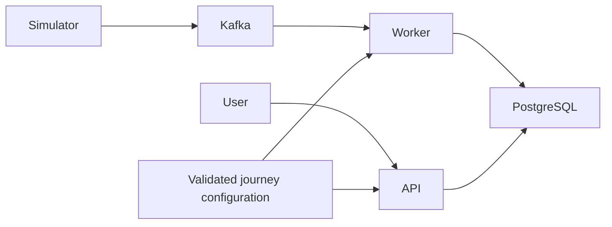

# Architecture

JourneySignal is a modular monolith with independently run API, worker and simulator
entrypoints. M1 detects deterministic quality failures in synthetic events and maps
them to configured **potential** journey exposure. It does not detect absent events,
send messages, resolve identities or measure revenue.



The domain uses only the standard library and immutable values. Pydantic parsing,
SQLAlchemy, Kafka and HTTP live outside it. Application protocols expose ingestion
transactions, query operations and time without exposing vendor objects.

```mermaid
sequenceDiagram
  participant K as Kafka
  participant W as Worker
  participant A as Ingestion application
  participant D as PostgreSQL
  K->>W: record (topic, partition, offset)
  W->>A: record + injected receive time
  A->>D: begin; claim transport receipt
  alt committed replay
    D-->>A: existing receipt
  else new receipt
    A->>D: claim logical ID; compare first digest
    A->>A: rules; journey association
    A->>D: event occurrence + findings + exposures
  end
  A->>D: commit
  A-->>W: handled
  W->>K: synchronous offset commit
```

## Guarantees and failure handling

Delivery is at least once with idempotent database writes. Transport identity has a
unique constraint; business identity has a separate registry. Each valid receipt
retains its own event occurrence, including business duplicates. Concurrent registry
claims must resolve atomically in PostgreSQL; Kafka partition ordering is insufficient.
The transaction includes receipt, registry, event, findings and exposures.

Malformed records are quarantined in PostgreSQL as bounded error metadata, without
raw bytes. This avoids a DB/DLQ dual-write requirement. Failed quarantine means no
acknowledgement. Transient DB failures retry with a finite jittered budget; exhaustion
stops the worker without committing the failed record. Rebalance or offset-commit
failure can replay committed work safely. No later offset is committed past failed work.

The API checks PostgreSQL for readiness, not Kafka. The worker exposes its own
heartbeat/readiness and metrics. Synchronous DB queries run in FastAPI sync routes.
The worker processes one record per transaction with bounded buffers. SQL performs
operational aggregation; Polars is restricted to offline measurements, with DuckDB
optional. Config errors fail startup. No payloads or arbitrary exception text enter logs.

## Time and measurement

Aware event and producer timestamps normalise to UTC. Receive time comes from an
injected clock, never a producer override. Persist time is separate. Wall time measures
event age; monotonic time measures execution duration. Freshness and future skew use
strict greater-than comparisons. Out-of-order delivery is not automatically a finding.

See the ADRs for choices and the implementation checklist for verification status.
